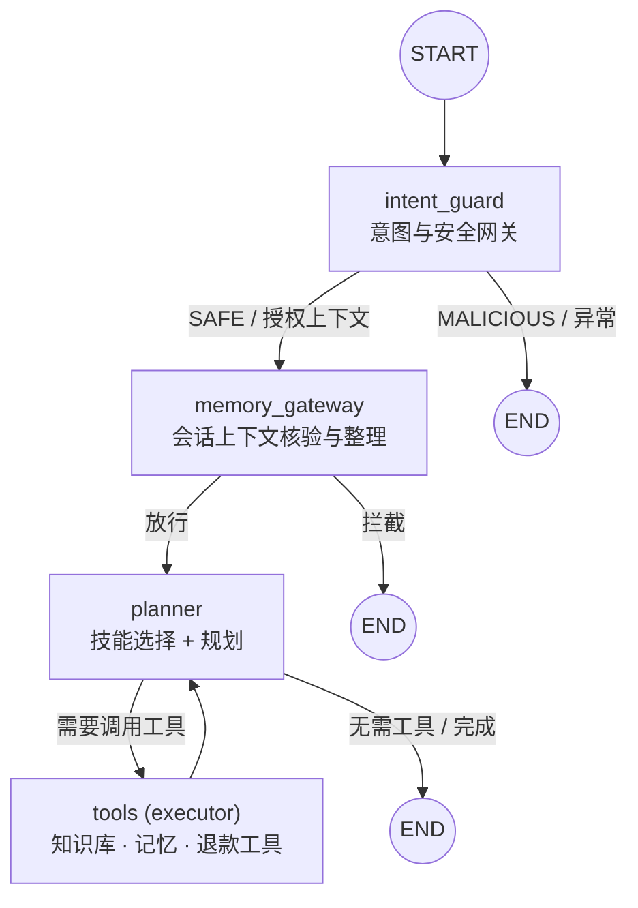
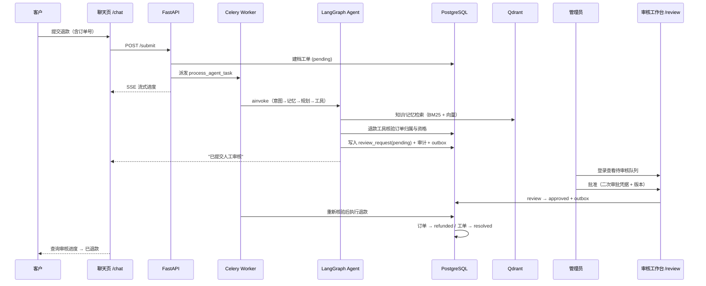
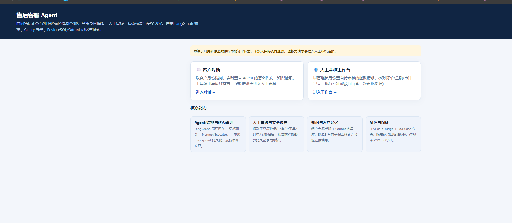
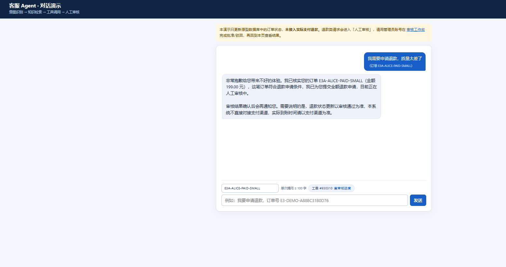
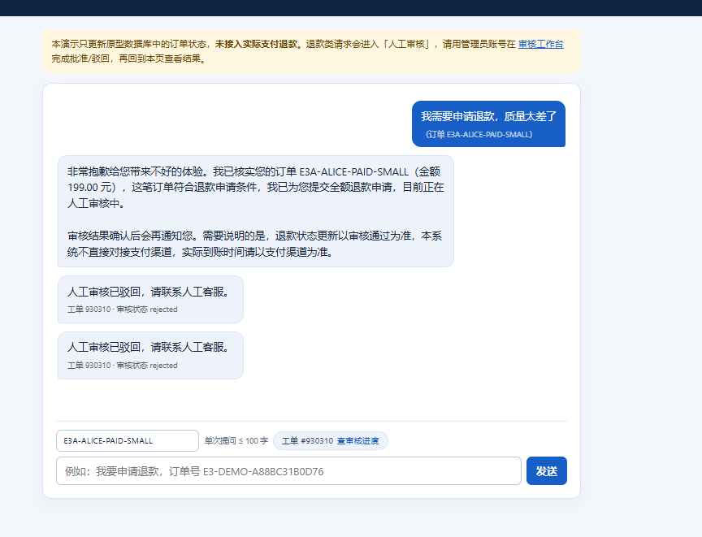
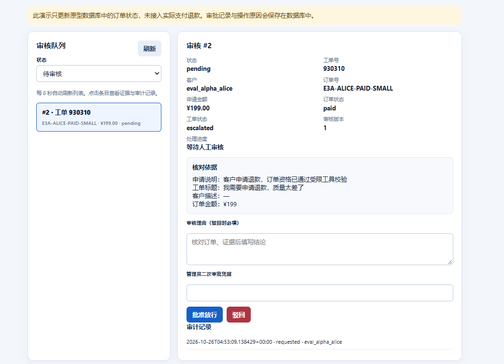
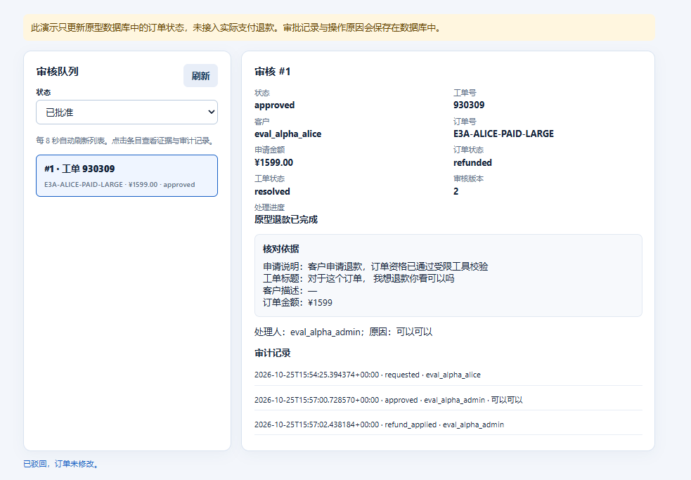
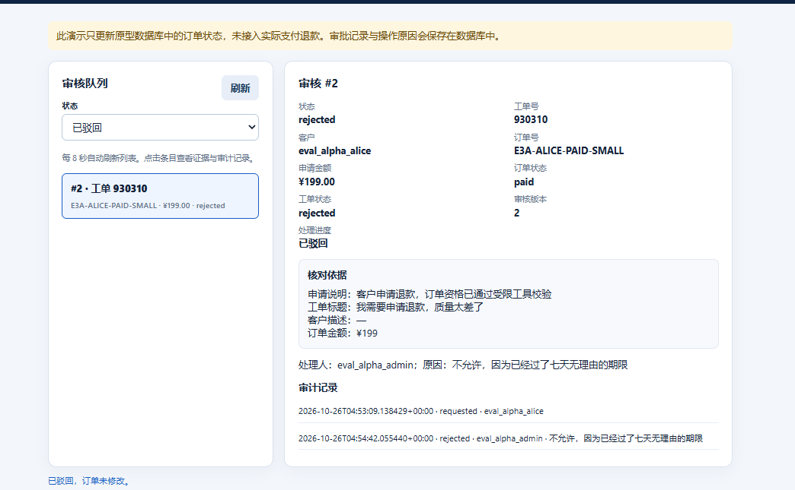

# 售后客服 Agent · After-sales Support Agent

一个面向**售后退款与知识咨询**的 LLM Agent，核心能力是 **人工审核、状态恢复、安全边界与可评估**。基于 LangGraph 编排，FastAPI + Celery + PostgreSQL + Redis + Qdrant 落地。

> ⚠️ 学习/演示用途：只更新原型数据库，未接入真实支付网关。

[](#)
[](#)
[](#)
[](#)
[](#)
[](#)

---

## ✨ 核心能力

| 能力 | 说明 |
|---|---|
| 🧭 **Agent 编排与状态管理** | LangGraph 意图网关 + 记忆网关 + Planner/Executor；工单级 Checkpoint 持久化到 Postgres，支持中断恢复与失败补偿 |
| 🛡️ **人工审核与安全边界** | 退款工具复核租户/客户/工单/订单/金额归属；RBAC + 二次审批凭据 + 版本号防重放；批准前拦截缺少持久记录的承诺 |
| 📚 **知识与客户记忆** | 租户专属手册 + Qdrant 向量库；BM25 与向量**混合检索**并校验证据编号；跨工单客户偏好记忆 |
| 📐 **测评与闭环迭代** | 规则护栏 + 状态断言 + LLM-as-a-Judge 语义复核；隔离环境回归 **59/60**，审核违规率 **2/21 → 0/21** |

---

## 🏗️ 架构

### Agent 编排（LangGraph 状态图）



### 退款审核全链路



---

## 🧰 技术栈

- **编排**：LangGraph + LangGraph Checkpoint（Postgres）
- **服务**：FastAPI + Uvicorn
- **异步任务**：Celery（Redis broker/backend）+ 分布式熔断器 + Tenacity 重试
- **存储**：PostgreSQL（SQLAlchemy + Alembic）/ Redis / Qdrant
- **模型**：DeepSeek（LLM）+ 阿里云 DashScope `text-embedding-v4`（Embedding）
- **可观测**：OpenTelemetry + Prometheus + JSON 结构化日志

---

## 🎬 演示

退款审核全链路（客户提交 → 人工审核 → 状态更新）：

**① 演示入口（/demo）**



**② 客户对话与状态查询（/chat）**





**③ 人工审核工作台（/review）**







三个页面：

| 路由 | 说明 |
|---|---|
| `/demo` | 演示入口页 |
| `/chat` | 客户对话：SSE 实时流式展示 Agent 的意图识别 → 知识检索 → 工具调用 → 回复 |
| `/review` | 管理员人工审核工作台：核对订单/金额/审计，批准或驳回 |

演示账号（密码在本地 `infra/eval-v3/.env`，不入库）：

| 角色 | 账号 |
|---|---|
| 客户 | `eval_alpha_alice` |
| 管理员 | `eval_alpha_admin` |

---

## 📊 评估结果

- **隔离边界回归**（`eval_v3/`）：M0 **12/12**、M1 **10/10**、M2/M3 **9/9**
- **端到端自动评分**（`eval_agent/`）：**59/60**
- **审核违规率**：**2/21 → 0/21**（Bad Case 分析定位"未审先判"幻觉，硬性兜底策略修复）
- **LLM-as-a-Judge 语义复核**（`eval_agent/judge.py`）：16 条含回复案例中，规则护栏全部通过；校准后的 Judge 额外识别出 **6 条**规则漏判的语义问题（Agent 向客户泄漏"我没有 XX 工具"等内部能力）。判据经人工校准，完整判定见 `eval_agent/results/judge_*.json`

不同评估范围与版本的分数不直接相加；详情见 `eval_v3/`、`eval_agent/` 与 `docs/`。

---

## 📁 项目结构

```
app/
  agent/       # LangGraph 节点（intent_guard / memory_gateway / planner / executor）+ 工具与技能
  api/         # FastAPI 路由、鉴权、限流
  core/        # 配置、DB、Redis、向量库、安全、可观测
  models/      # SQLAlchemy 模型
  workers/     # Celery 任务、熔断器、进度事件、outbox 投递
  web/         # demo 页面（chat / review / demo）
migrations/    # Alembic 迁移
eval_v3/       # M0–M3 隔离边界回归
eval_agent/    # 端到端 Agent、故障、知识库与记忆评估
infra/         # Docker Compose（PostgreSQL / Redis / Qdrant）
docs/          # 架构、评估分析、故障排查记录
```

---

## 🚀 本地运行

```bash
# 1) 启动隔离基础设施（Postgres / Redis / Qdrant）
docker compose --env-file infra/eval-v3/.env -f infra/eval-v3/compose.yaml -p agent_eval_v3 up -d

# 2) 建集合 → 建表 → 灌演示数据
./infra/eval-v3/run.ps1 -Exe python -Arguments @('scripts/init_eval_qdrant.py')
./infra/eval-v3/run.ps1 -Exe python -Arguments @('-m','alembic','upgrade','head')
./infra/eval-v3/run.ps1 -Exe python -Arguments @('eval_v3/seed.py','--apply')

# 3) 三个进程各开一个终端（都要常驻）
./infra/eval-v3/run.ps1 -Exe python -Arguments @('scripts/run_api.py','--host','127.0.0.1','--port','58080')
./infra/eval-v3/run.ps1 -Exe python -Arguments @('-m','celery','-A','app.workers.celery_app:celery_app','worker','--pool=solo','--loglevel=INFO')
./infra/eval-v3/run.ps1 -Exe python -Arguments @('-m','celery','-A','app.workers.celery_app:celery_app','beat','--loglevel=INFO','--schedule','infra/eval-v3/celerybeat-schedule')
```

浏览器打开 `http://127.0.0.1:58080/demo`。详细启动/账号说明见 `docs/review-demo.md` 与 `infra/eval-v3/README.md`。

---

## 📝 说明

- 本系统为个人学习与求职展示用途，**未接入真实支付网关**；`refunded` 只是原型数据库的状态。
- 敏感配置（API key、密码、审批凭据）均在 `.env` 中，已通过 `.gitignore` 排除，不入库。
