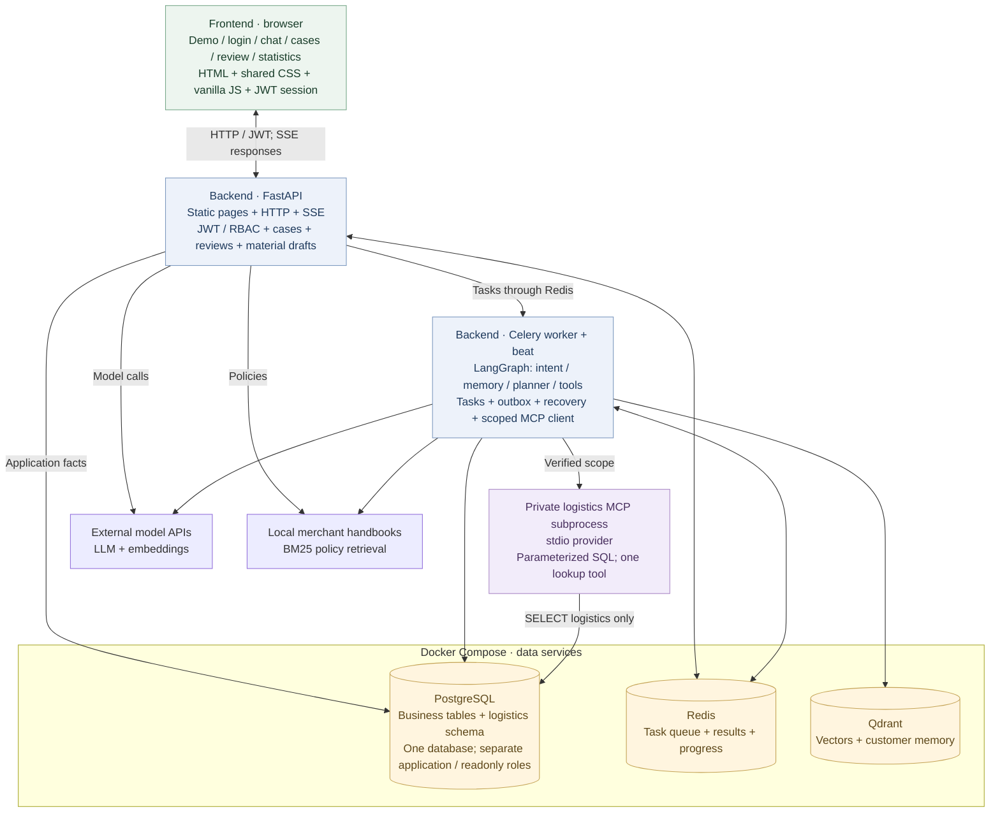

# After-sales Support Agent & Workbench

[简体中文](README.zh-CN.md) · [Demo guide](docs/workbench-demo.md) · [Logistics MCP](docs/logistics-mcp.md) · [MIT](LICENSE)

A runnable after-sales support project that connects **customer conversations, case handling, human refund review, and logistics lookup**. LangGraph orchestrates the Agent; a role-based browser interface lets customers, support staff, reviewers, and analysts follow the same case.

> All demo merchants, orders, policies, and tracking events are synthetic. Refund execution changes prototype records only; no payment gateway or live carrier API is connected.

## What you can demonstrate

| Scenario | Flow | What to inspect |
| --- | --- | --- |
| Cancel an unshipped order | Support checks facts and policy → reviewer decides → worker performs the simulated action | Pending review, approval, and execution completion are distinct states |
| Request a refund after shipment | Agent checks the order → queries logistics through MCP → consults merchant policy | Two packages can have different statuses; shipment does not permit a direct refund |
| Continue an existing request | Customer explicitly associates the original `case_id` → support sees the combined contact history | Different requests on the same order are not automatically merged |

The initial fixture contains **28 orders, 14 cases, 15 contacts, 8 accounts, 4 packages, and 8 tracking events**, including a second merchant for isolation checks. Some history is pre-seeded for demonstration, not generated by a model run. Repeated initialization preserves existing demo edits.

## Features

- **Unified login and role-based views.** JWT authentication, current account/merchant/role checks against PostgreSQL, tab-scoped session storage, and role-aware navigation. Backend authorization remains authoritative.
- **Case collaboration.** Explicit follow-up association, contact history, notes, work items, classification, tenant-scoped cursors, and optimistic version checks.
- **Review material assistance.** Database facts and retrieved merchant policies remain separate from optional model-generated summaries. Invalid output, invented policy IDs, and provider failures trigger an explicitly labeled fallback.
- **Human refund review.** Second-approval credentials, version checks, audit records, transactional outbox delivery, and recovery of approved simulated refunds.
- **Logistics MCP + SQL.** A private stdio provider exposes one scoped lookup tool backed by PostgreSQL. It supports split shipments, parameterized queries, bounded results, and a dedicated readonly database role.
- **Knowledge and memory.** Merchant-scoped handbooks, BM25/dense/hybrid retrieval, evidence identifiers, ticket checkpoints, and customer-scoped memory. The lightweight demo uses BM25 for policy retrieval.
- **Operational statistics and observability.** Readonly case counts and classification distributions, coarse SSE progress, structured logs, OpenTelemetry, and Prometheus metrics.

## Frontend and backend architecture



The frontend consists of **HTML pages, shared CSS, and vanilla JavaScript** served by the same FastAPI application. There is no separate frontend build service. API and worker processes currently run on the host; Compose runs the database, Redis, and Qdrant services. Each logistics lookup starts and closes its own MCP subprocess.

The model-assisted material endpoint is a direct API call, while customer conversations execute through Celery and LangGraph. Both use the existing model configuration. BM25 reads local merchant handbooks; vector retrieval and long-term memory use Qdrant and the embedding provider when required.

## Quick start

The verified local setup uses **Windows, Python 3.14, Docker Desktop, and MCP Python SDK 1.27.2**. The code uses Python 3.12+ APIs. Most dependencies remain unpinned; a complete lockfile is not yet provided.

From the repository root, prepare a virtual environment if needed:

```powershell
python -m venv .venv
.\.venv\Scripts\python.exe -m pip install -r requirements.txt "mcp==1.27.2"
```

For live conversations and model-assisted drafts, configure the following in the ignored `app/.env` file or environment. Use your own values:

```dotenv
DEEPSEEK_API_KEY=your-model-api-key
DASHSCOPE_API_KEY=your-embedding-api-key
```

Additional model options are defined in [config.py](app/core/config.py). Without a detected chat model key, the launcher enables **data browsing and fact-material mode**: chat dispatch and review decisions are disabled. Key detection does not validate provider connectivity. Initialization itself does not call external models; sending a message or generating an AI draft can do so.

Start Docker Desktop, then run:

```powershell
.\.venv\Scripts\python.exe scripts/run_workbench_demo.py
```

Open **[the demo](http://127.0.0.1:8001/demo)** or **[the login page](http://127.0.0.1:8001/login)**. The launcher starts isolated infrastructure, applies migrations, seeds synthetic data, configures readonly roles, and starts the API. When a model key is detected, it also starts a worker and beat. It preserves the original `app/.env` and existing `agent_db` environment.

| Role | Account | Default page | Access |
| --- | --- | --- | --- |
| Customer (`user`) | `demo_echo_alice` | `/chat` | Submit questions, explicitly continue a request, query own review status |
| Support (`staff`) | `demo_echo_staff` | `/workbench` | Cases, notes, work items, review materials |
| Reviewer (`admin`) | `demo_echo_admin` | `/review` | Approve/reject; also access cases and statistics |
| Analyst (`analyst`) | `demo_echo_analyst` | `/workbench?tab=analytics` | Readonly operational statistics |

Demo passwords and the second-approval credential are printed in the startup terminal and stored in the ignored `infra/workbench-demo/.env`. The login-page account buttons only prefill usernames. To switch roles, log out and authenticate with another account.

Useful launcher options:

```powershell
# Prepare infrastructure and data without starting API/worker processes.
.\.venv\Scripts\python.exe scripts/run_workbench_demo.py --prepare-only
# Choose another API port.
.\.venv\Scripts\python.exe scripts/run_workbench_demo.py --port 8002
```

Ctrl+C stops the launcher-owned API, worker, and beat processes. Container data remains available for the next run. Stop the demo containers with:

```powershell
docker compose -p workbench-demo --env-file infra/workbench-demo/.env -f infra/workbench-demo/compose.yaml stop
```

| Service | Local address / port |
| --- | --- |
| FastAPI and frontend | `127.0.0.1:8001` |
| Demo PostgreSQL | `127.0.0.1:55459` |
| Demo Redis | `127.0.0.1:56380` |
| Demo Qdrant | `127.0.0.1:56335` |
| Disposable integration-test PostgreSQL | `127.0.0.1:55458` |

## Try the logistics scenario

Log in as `demo_echo_alice`, select order `DEMO-ECHO-002`, and optionally continue case `CASE-DEMO-SHIPPED`. Ask:

> Order DEMO-ECHO-002 has shipped, but I want a refund. Please check both packages and explain the next step using the merchant policy.

The synthetic records contain one package in transit and another delivered. The Agent should distinguish the packages, label the data as demo tracking, and explain the need for human verification without executing a refund or claiming an interception. `last_event_at` is the tracking event time; `queried_at` is only the lookup time. Expand **本次处理记录** in the chat to inspect the actual coarse processing events.

## Identity, readonly access, and MCP boundaries

| Layer | Responsibility |
| --- | --- |
| JWT + account lookup | Authenticate the requester and recheck current account, merchant, and role |
| Business authorization | Verify the customer, ticket, and bound order before a logistics lookup |
| MCP adapter | Launch a private stdio child with only the readonly connection and verified query scope |
| PostgreSQL role + transaction | Restrict SQL capabilities, use a readonly transaction, and bound statement execution |

**Readonly access does not mean a separate readonly database or replica.** The demo uses different accounts in the same PostgreSQL database: `wb_demo` for application work, `wb_demo_reader` for case statistics, and `wb_logistics_reader` for logistics SELECTs. The latter cannot read the business orders table. JWT authorization and SQL privileges protect different boundaries.

The logistics provider reads `logistics.shipments` and `logistics.shipment_events`; it has no refund, address-change, interception, or arbitrary-SQL tool. It refuses missing configuration and privileged connections instead of falling back to the business connection. Scope isolation relies on the trusted worker and the fixed provider queries; this private stdio service is not an authenticated public HTTP MCP endpoint. See [the logistics design](docs/logistics-mcp.md).

## Validation and evaluation

| Scope | Recorded result | Interpretation |
| --- | --- | --- |
| Current workbench + logistics integration | **40 passed, 0 failures/errors** | Disposable PostgreSQL, real stdio MCP discovery/calls, ownership, readonly privileges, migrations, concurrency, and failure handling; no external model calls |
| Current frontend checks | **12 browser checks passed** | Login, role routing, session refresh/expiry, policy material, cross-page navigation, logout, and mobile layout |
| Separate live logistics conversation | **One observed successful run** | Browser → API → Celery → Agent → MCP → SQL; distinguished two packages and retained the shipped-order refund restriction |
| Historical Agent auto-scoring | **59/60**; review violations **2/21 → 0/21** | Earlier synthetic scenarios and versions; not rerun as part of this feature |
| Historical retrieval baseline | **hit@1 0.93 / recall@3 1.00 / MRR@3 0.97** | 15 labeled synthetic queries |
| Historical RAGAS evaluation | **0.94 / 0.75 / 0.96** faithfulness / answer relevancy / context precision | 30 synthetic Q&A pairs, with **22 / 30 / 23** valid samples after judge timeouts |

Run the current integration suite from the repository root:

```powershell
docker compose -p workbench-tests -f infra/workbench-tests/compose.yaml up -d --wait
.\.venv\Scripts\python.exe scripts/run_workbench_tests.py
docker compose -p workbench-tests -f infra/workbench-tests/compose.yaml stop
```

The runner and tests enforce the disposable `55458/workbench_test` target and reset its synthetic fixtures. Reports are written to ignored `eval_workbench/results/`. The integration count, browser checks, live observation, and historical model metrics cover different scopes and must not be combined into one success rate. These are demo validations, not measurements of production reliability or customer-service efficiency.

Historical evaluation code lives in [eval_agent](eval_agent/), [eval_v3](eval_v3/), and [eval_external](eval_external/). The separate legacy review-demo setup is documented in [review-demo.md](docs/review-demo.md); its accounts and port `58080` are not the default workbench demo described here.

## Project map

```text
app/
  web/             HTML views + shared CSS/JS + session handling
  api/             JWT/RBAC, cases, reviews, materials, operational statistics
  agent/           LangGraph nodes, skills, tool allowlists, ownership checks
  services/        Case operations, review-material generation, synthetic seeding
  integrations/    Scoped MCP client and subprocess lifecycle
  mcp_servers/     Logistics provider and parameterized PostgreSQL queries
  workers/         Celery tasks, beat recovery, outbox delivery, SSE events
  core/            Settings, connections, security, tracing, metrics
  models/          Application SQLAlchemy models
demo/              Synthetic workbench and logistics fixtures
migrations/        Application tables and logistics-schema migrations
infra/             Isolated demo and disposable test Compose services
scripts/           Startup, seeding, backfill, account setup, test runner
tests/             PostgreSQL/HTTP/MCP integration suite
docs/              Feature guides and historical evaluation notes
```

## Current scope

Operational statistics cover case counts and classifications, not a complete business analytics warehouse. Order-amount precision migration, live carrier integration, public/remote MCP authentication, full-history UI pagination, and real payment integration are not implemented. The current demo uses host API/worker processes and Compose-managed data services; it has no Kubernetes deployment.

Some feature guides are in Chinese: [demo and walkthrough](docs/workbench-demo.md), [logistics MCP](docs/logistics-mcp.md), [initial workbench APIs and migration notes](docs/workbench-phase1.md), and [lightweight project plan](docs/workbench-plan.md). The phase-one document records its original delivery scope; use this README and the demo/MCP guides for the current feature set.

## License

[MIT](LICENSE) © 2026 OliverKatKat
