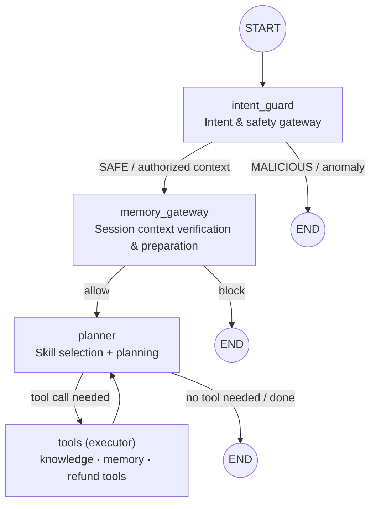
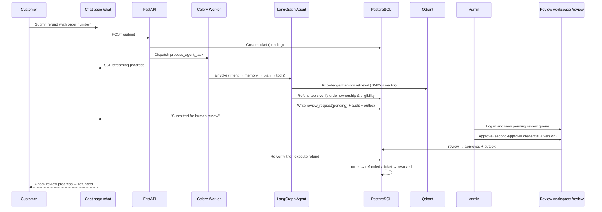

# After-sales Support Agent

An LLM agent for **after-sales refunds and knowledge-based support**, with first-class support for **human review, state recovery, safety boundaries, and evaluability**. Orchestrated with LangGraph and built on FastAPI + Celery + PostgreSQL + Redis + Qdrant.

> ⚠️ Learning/demo use only: it updates a prototype database and is **not connected to a real payment gateway**.

[](#)
[](#)
[](#)
[](#)
[](#)
[](#)
[](LICENSE)
[](README.zh-CN.md)

---

## ✨ Core Capabilities

| Capability | Description |
|---|---|
| 🧭 **Agent orchestration & state management** | LangGraph intent gateway + memory gateway + Planner/Executor; ticket-level checkpoints persisted to Postgres, with interrupt recovery and failure compensation |
| 🛡️ **Human review & safety boundaries** | Refund tools re-verify tenant/customer/ticket/order/amount ownership; RBAC + second-approval credential + version-based replay protection; blocks commitments that lack a persistent record before approval |
| 📚 **Knowledge & customer memory** | Tenant-specific handbook + Qdrant vector store; BM25 + vector **hybrid retrieval** with evidence-ID validation; measurable retrieval (hit@1 / recall@3 / MRR@3); cross-ticket customer preference memory |
| 📐 **Evaluation & closed-loop iteration** | Rule guards + state assertions + LLM-as-a-Judge semantic review; isolation regression **59/60**, violation rate **2/21 → 0/21**; RAGAS metrics + retrieval baselines |

---

## 🏗️ Architecture

### Agent orchestration (LangGraph state graph)



### Refund review end-to-end flow



---

## 🧰 Tech Stack

- **Orchestration**: LangGraph + LangGraph Checkpoint (Postgres)
- **Services**: FastAPI + Uvicorn
- **Async tasks**: Celery (Redis broker/backend) + distributed circuit breaker + Tenacity retries
- **Storage**: PostgreSQL (SQLAlchemy + Alembic) / Redis / Qdrant
- **Models**: DeepSeek (LLM) + Alibaba Cloud DashScope `text-embedding-v4` (embeddings)
- **Observability**: OpenTelemetry + Prometheus + structured JSON logging

---

## 🎬 Demo

Refund review end-to-end (customer submits → human review → status update):

**① Demo landing page (/demo)**


**② Customer chat & status lookup (/chat)**


**③ Human review workspace (/review)**


Three pages:

| Route | Description |
|---|---|
| `/demo` | Demo landing page |
| `/chat` | Customer chat: SSE live streaming of the agent's intent detection → knowledge retrieval → tool calls → reply |
| `/review` | Admin human-review workspace: verify order/amount/audit, then approve or reject |

Demo accounts (passwords live in the local `infra/eval-v3/.env` and are not committed):

| Role | Account |
|---|---|
| Customer | `eval_alpha_alice` |
| Admin | `eval_alpha_admin` |

---

## 📊 Evaluation Results

- **Isolation-boundary regression** (`eval_v3/`): M0 **12/12**, M1 **10/10**, M2/M3 **9/9**
- **End-to-end auto-scoring** (`eval_agent/`): **59/60**
- **Review violation rate**: **2/21 → 0/21** (bad-case analysis traced the "decide before review" hallucination; a hard fallback policy fixed it)
- **LLM-as-a-Judge semantic review** (`eval_agent/judge.py`): all rule guards passed on the 16 reply-bearing cases; the calibrated judge additionally caught **6** semantic issues that the rules missed (e.g. the agent leaking internal capability like "I don't have an XX tool"). Judging criteria were manually calibrated; full verdicts are in `eval_agent/results/judge_*.json`
- **Retrieval evaluation baseline** (`eval_agent/benchmark_retrieval.py`): 15 synthetic labeled queries; hybrid (BM25 + dense) baseline **hit@1 0.93 / recall@3 1.00 / MRR@3 0.97**; reports in `eval_agent/results/retrieval_*.json`
- **RAG quality evaluation** (`eval_external/ragas_eval.py`): RAGAS 0.2.15 scored **30 synthetic Q&A pairs**; mean faithfulness / answer_relevancy / context_precision **0.94 / 0.75 / 0.96** (valid samples **22 / 30 / 23** after excluding judge timeouts); reports in `eval_external/results/ragas_*.json`

> All evaluation cases and knowledge bases are **synthetic data** (fictional merchant EVAL); scores across different scopes and versions do not simply add up. See `eval_v3/`, `eval_agent/`, `eval_external/`, and `docs/` for details.

---

## 📁 Project Structure

```
app/
  agent/       # LangGraph nodes (intent_guard / memory_gateway / planner / executor) + tools & skills
  api/         # FastAPI routes, auth, rate limiting
  core/        # config, DB, Redis, vector store, security, observability
  models/      # SQLAlchemy models
  workers/     # Celery tasks, circuit breaker, progress events, outbox delivery
  web/         # demo pages (chat / review / demo)
migrations/    # Alembic migrations
eval_v3/       # M0–M3 isolation-boundary regression
eval_agent/    # end-to-end agent, fault, knowledge, and memory evaluation
eval_external/ # RAGAS evaluation scripts, question sets, and results
infra/         # Docker Compose (PostgreSQL / Redis / Qdrant)
docs/          # architecture, evaluation analysis, troubleshooting notes
```

---

## 🚀 Running Locally

```bash
# 1) Start isolated infrastructure (Postgres / Redis / Qdrant)
docker compose --env-file infra/eval-v3/.env -f infra/eval-v3/compose.yaml -p agent_eval_v3 up -d

# 2) Create collections → migrate tables → seed demo data
./infra/eval-v3/run.ps1 -Exe python -Arguments @('scripts/init_eval_qdrant.py')
./infra/eval-v3/run.ps1 -Exe python -Arguments @('-m','alembic','upgrade','head')
./infra/eval-v3/run.ps1 -Exe python -Arguments @('eval_v3/seed.py','--apply')

# 3) Run these three long-lived processes, each in its own terminal
./infra/eval-v3/run.ps1 -Exe python -Arguments @('scripts/run_api.py','--host','127.0.0.1','--port','58080')
./infra/eval-v3/run.ps1 -Exe python -Arguments @('-m','celery','-A','app.workers.celery_app:celery_app','worker','--pool=solo','--loglevel=INFO')
./infra/eval-v3/run.ps1 -Exe python -Arguments @('-m','celery','-A','app.workers.celery_app:celery_app','beat','--loglevel=INFO','--schedule','infra/eval-v3/celerybeat-schedule')
```

Open `http://127.0.0.1:58080/demo` in your browser. For detailed startup/account instructions, see `docs/review-demo.md` and `infra/eval-v3/README.md`.

---

## 📝 Notes

- This system is for personal learning and demonstration and is **not connected to a real payment gateway**; `refunded` is only a state in the prototype database.

---

## 📄 License

[MIT](LICENSE) © 2026 OliverKatKat
