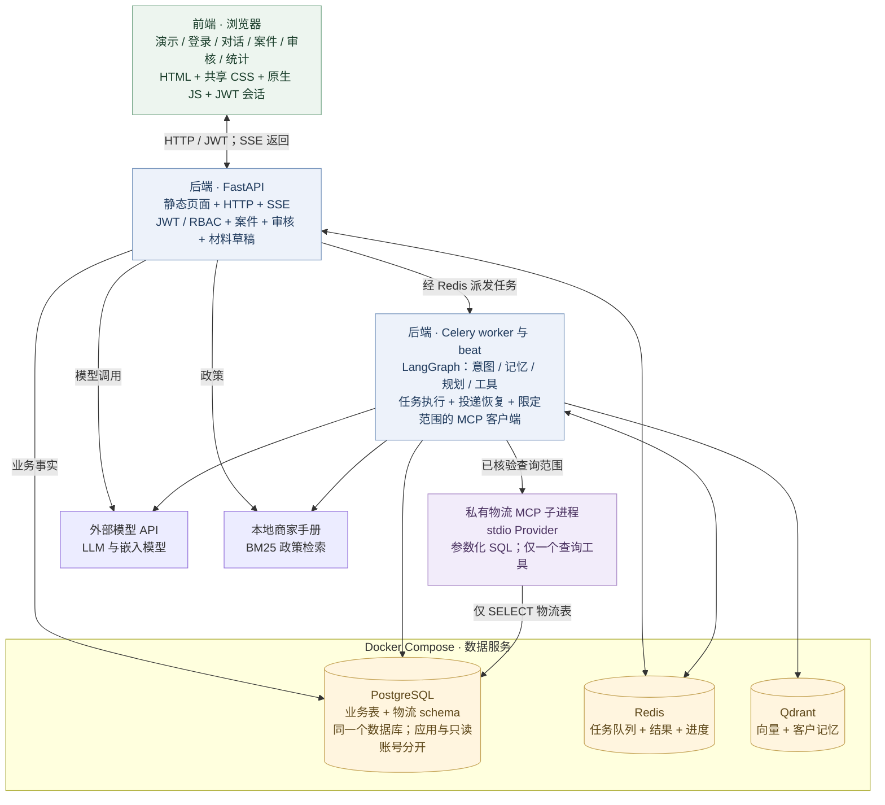

# 售后客服 Agent 与协同工作台

[English](README.md) · [演示指南](docs/workbench-demo.md) · [物流 MCP](docs/logistics-mcp.md) · [MIT](LICENSE)

一个可运行的售后服务项目，串起**客户对话、案件跟进、人工退款审核和物流查询**。LangGraph 负责 Agent 编排；浏览器前端按账号角色展示对应视图，让客户、专员、主管和分析员围绕同一案件协作。

> 演示商家、订单、政策和物流轨迹均为合成数据。退款只更新原型记录，未接真实支付网关或快递 API。

## 可以演示什么

| 场景 | 处理流程 | 核对重点 |
| --- | --- | --- |
| 未发货，想取消订单 | 专员核对事实和政策 → 主管审核 → worker 模拟执行 | 待审核、已批准、执行完成是不同状态 |
| 已发货，申请退款 | Agent 查订单 → 通过 MCP 查物流 → 检索商家政策 | 两个包裹可处于不同状态；已发货不能直接退款 |
| 补充上次的申请 | 客户显式关联原 `case_id` → 专员查看前后联系 | 同一订单的不同诉求不会自动合并 |

初始样本包含 **28 笔订单、14 个案件、15 次联系、8 个账号、4 个包裹和 8 条轨迹**，其中少量第二商家数据用于隔离检查。部分历史状态由初始化预置，不代表模型实时处理结果；重复初始化保留已有演示修改。

## 已实现功能

- **统一登录与角色视图。** JWT 鉴权后，查询 PostgreSQL 复核账号、商家和当前角色；标签页会话存储保留登录，导航按角色显示，实际权限由后端校验。
- **案件协作。** 显式续办、联系记录、人工备注、待办、分类、限定商家范围的游标和乐观版本检查。
- **审核材料助手。** 数据库事实、检索到的商家政策和可选模型摘要分别呈现。字段不合法、引用政策编号不存在或模型调用失败时，明确回退到事实模板。
- **人工退款审核。** 二次审批凭据、版本校验、审计记录、事务 Outbox 投递，以及已批准模拟退款的恢复处理。
- **物流 MCP 与 SQL。** 私有 stdio 服务暴露一个限定范围的查询工具，使用 PostgreSQL、参数化 SQL、独立只读账号及返回数量限制，支持一单多包裹。
- **知识与记忆。** 商家专属手册、BM25／向量／混合检索、依据编号、工单 Checkpoint 和客户范围的记忆。轻量演示的政策检索使用本地 BM25。
- **台账与可观测。** 只读案件计数和分类分布、SSE 粗粒度处理进度、结构化日志、OpenTelemetry 和 Prometheus 指标。

## 前端与后端由什么组成



前端由 **HTML 页面、共享 CSS 和原生 JavaScript** 组成，通过同一个 FastAPI 应用提供，没有独立的前端构建服务。当前 API、worker 和 beat 在宿主机运行，Compose 管理 PostgreSQL、Redis 和 Qdrant；每次物流查询按需启动并关闭一个 MCP 子进程。

审核材料由 API 直接调用模型整理，客户对话则经 Celery 和 LangGraph 执行，两者使用已有模型配置。BM25 直接读取本地商家手册；需要时，向量检索和长期记忆使用 Qdrant 及嵌入模型。

## 快速启动

已验证的本地环境为 **Windows、Python 3.14、Docker Desktop、MCP Python SDK 1.27.2**。代码使用 Python 3.12+ 接口；多数依赖尚未固定版本，当前没有完整依赖锁文件。

在仓库根目录中，按需创建虚拟环境并安装依赖：

```powershell
python -m venv .venv
.\.venv\Scripts\python.exe -m pip install -r requirements.txt "mcp==1.27.2"
```

如需真实对话和模型审核草稿，在已忽略提交的 `app/.env` 或环境变量中配置自己的密钥：

```dotenv
DEEPSEEK_API_KEY=your-model-api-key
DASHSCOPE_API_KEY=your-embedding-api-key
```

其他模型参数见 [config.py](app/core/config.py)。未检测到聊天模型密钥时，启动器启用**数据浏览与事实材料模式**，不派发聊天或审批任务。检测到密钥不代表已经验证模型服务连通性。初始化数据不调用外部模型；发送消息、生成 AI 草稿时可能产生模型调用。

打开 Docker Desktop，再执行：

```powershell
.\.venv\Scripts\python.exe scripts/run_workbench_demo.py
```

打开 **[演示首页](http://127.0.0.1:8001/demo)** 或 **[统一登录](http://127.0.0.1:8001/login)**。启动器准备隔离基础设施、执行迁移、填入合成样本、配置只读账号并启动 API；检测到模型密钥时，同时启动 worker 和 beat。已有 `app/.env` 和原 `agent_db` 环境保留。

| 角色 | 演示账号 | 默认页面 | 可用功能 |
| --- | --- | --- | --- |
| 客户 `user` | `demo_echo_alice` | `/chat` | 提问、显式继续原申请、查询本人审核进度 |
| 专员 `staff` | `demo_echo_staff` | `/workbench` | 案件、备注、待办、审核材料 |
| 主管 `admin` | `demo_echo_admin` | `/review` | 批准／驳回，也可进入案件和统计 |
| 分析员 `analyst` | `demo_echo_analyst` | `/workbench?tab=analytics` | 只读台账统计 |

演示密码和二次审批凭据显示在启动终端，并保存在忽略提交的 `infra/workbench-demo/.env`。登录页的账号按钮仅预填用户名；切换身份时先退出，再用另一账号登录。

其他启动选项：

```powershell
# 只准备基础设施与样本，不启动 API、worker。
.\.venv\Scripts\python.exe scripts/run_workbench_demo.py --prepare-only
# 更换 API 端口。
.\.venv\Scripts\python.exe scripts/run_workbench_demo.py --port 8002
```

Ctrl+C 停止本次启动器所属的 API、worker 和 beat，容器数据保留供下次使用。停止演示容器：

```powershell
docker compose -p workbench-demo --env-file infra/workbench-demo/.env -f infra/workbench-demo/compose.yaml stop
```

| 服务 | 本地地址／端口 |
| --- | --- |
| FastAPI 与前端 | `127.0.0.1:8001` |
| 演示 PostgreSQL | `127.0.0.1:55459` |
| 演示 Redis | `127.0.0.1:56380` |
| 演示 Qdrant | `127.0.0.1:56335` |
| 一次性集成测试 PostgreSQL | `127.0.0.1:55458` |

## 体验物流查询

用 `demo_echo_alice` 登录，选择订单 `DEMO-ECHO-002`，可显式继续案件 `CASE-DEMO-SHIPPED`，然后提问：

> 订单 DEMO-ECHO-002 已发货，我想退款。请先查两个包裹的物流，再结合商家政策说明怎么处理。

合成轨迹中，一个包裹运输中，另一个已签收。Agent 应分别说明状态，标注为演示物流，并建议人工核实后续安排；不能执行退款或声称已拦截包裹。`last_event_at` 是轨迹事件时间，`queried_at` 只是本次查询时间。聊天中可展开**本次处理记录**，查看后台实际返回的粗粒度进度。

## 身份、只读权限与 MCP 边界

| 层次 | 负责什么 |
| --- | --- |
| JWT 与账号查询 | 确认请求身份，复核账号、商家和当前角色 |
| 业务授权 | 查询物流前核对客户、工单与绑定订单 |
| MCP 适配层 | 启动私有 stdio 子进程，只传只读连接及已核验的查询范围 |
| PostgreSQL 账号与事务 | 限制 SQL 能力，使用只读事务和语句执行时限 |

**只读连接不代表独立只读数据库或只读副本。** 演示中，`wb_demo`、`wb_demo_reader`、`wb_logistics_reader` 连接同一个 PostgreSQL 数据库，分别用于应用业务操作、案件统计和物流 SELECT。物流账号不能读取主业务订单表。JWT 业务授权和数据库权限约束的是不同边界。

物流 Provider 只读 `logistics.shipments` 与 `logistics.shipment_events`，没有退款、改地址、拦截或任意 SQL 工具。缺少配置或连接权限过大时拒绝查询，不回退主库连接。查询范围依赖受信任的 worker 和固定 SQL；当前私有 stdio 服务不是可直接公开的、带认证的 HTTP MCP 接口。详细设计见[物流说明](docs/logistics-mcp.md)。

## 验证与评测

| 范围 | 已记录结果 | 如何理解 |
| --- | --- | --- |
| 当前工作台与物流集成 | **40 项通过，0 失败／错误** | 一次性 PostgreSQL、真实 stdio MCP 发现与调用、归属隔离、只读权限、迁移、并发与失败回退；不调用外部模型 |
| 当前前端检查 | **12 项浏览器检查通过** | 登录、角色跳转、刷新／过期、政策材料、跨页导航、退出和手机布局 |
| 单独的真实物流对话 | **一次实际运行成功** | 前端 → API → Celery → Agent → MCP → SQL，区分两个包裹并保留已发货禁止直接退款的限制 |
| 历史 Agent 自动评分 | **59/60**；审核违规 **2/21 → 0/21** | 早期合成用例和版本，本次功能未重跑 |
| 历史检索基线 | **hit@1 0.93 / recall@3 1.00 / MRR@3 0.97** | 15 条合成标注查询 |
| 历史 RAGAS 评测 | faithfulness / answer relevancy / context precision **0.94 / 0.75 / 0.96** | 30 条合成问答；排除判官超时后，有效样本分别为 **22 / 30 / 23** |

在仓库根目录运行当前集成检查：

```powershell
docker compose -p workbench-tests -f infra/workbench-tests/compose.yaml up -d --wait
.\.venv\Scripts\python.exe scripts/run_workbench_tests.py
docker compose -p workbench-tests -f infra/workbench-tests/compose.yaml stop
```

脚本与测试共同限制目标为一次性的 `55458/workbench_test`，会重置其中的合成样本。报告写入忽略提交的 `eval_workbench/results/`。集成测试、浏览器检查、真实对话观察及历史模型指标覆盖不同范围，不能合并成一个成功率，也不代表已测得生产可靠性或客服提效。

历史评测代码位于 [eval_agent](eval_agent/)、[eval_v3](eval_v3/)、[eval_external](eval_external/)。独立的旧审核演示环境见 [review-demo.md](docs/review-demo.md)，其中的账号与 `58080` 端口不是本文默认的工作台演示配置。

## 项目结构

```text
app/
  web/             HTML 视图、共享 CSS/JS、会话处理
  api/             JWT/RBAC、案件、审核、材料、台账统计
  agent/           LangGraph 节点、技能、工具白名单、归属校验
  services/        案件操作、材料生成、合成数据初始化
  integrations/    限定范围的 MCP 客户端与子进程生命周期
  mcp_servers/     物流服务与参数化 PostgreSQL 查询
  workers/         Celery 任务、beat 恢复、Outbox 投递、SSE 事件
  core/            配置、连接、安全、追踪与指标
  models/          应用 SQLAlchemy 模型
demo/              工作台与物流合成样本
migrations/        应用业务表与物流 schema 迁移
infra/             隔离演示与一次性测试 Compose 服务
scripts/           启动、灌数、回填、账号配置、测试入口
tests/             PostgreSQL、HTTP 与 MCP 集成检查
docs/              功能指南与历史评测记录
```

## 当前范围

台账统计支持案件计数与分类分布，尚未建设完整经营分析仓库。订单金额精度迁移、真实快递接入、公开／远程 MCP 鉴权、完整历史的前端分页、真实支付接入尚未实现。当前为宿主机 API／worker 加 Compose 数据服务，没有 Kubernetes 部署。

进一步阅读：[演示与讲解脚本](docs/workbench-demo.md)、[物流 MCP](docs/logistics-mcp.md)、[首批工作台接口与迁移记录](docs/workbench-phase1.md)、[轻量项目计划](docs/workbench-plan.md)。首批文档保留当时的交付范围，当前功能以本 README、演示和物流指南为准。

## 许可证

[MIT](LICENSE) © 2026 OliverKatKat
