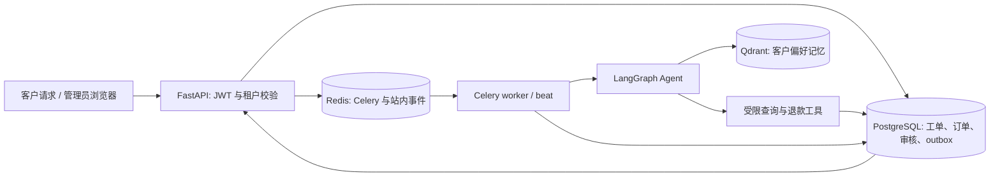

# 客服 Agent M0–M3 技术调研与实施复盘

> 截止日期：2026-10-06。本文以当前项目代码、路线图、隔离评估报告和一次浏览器人工审核记录为依据。这里的“退款完成”只指**原型数据库**中订单状态更新为 `refunded`；项目没有接入支付网关，也没有发起真实打款。

## 1. 项目起点与要解决的问题

原项目已有 FastAPI、Celery、LangGraph、PostgreSQL、Redis、Qdrant，以及基于工单的对话 checkpoint。但原有工单/记忆流程没有完整区分“商户、客户、工单、一次请求、一次 trace”；退款审批主要靠终端提示和一次管理员接口，缺少可见的待审队列、持久审核记录、驳回路径和批准后的故障处理。这样可以演示 Agent 调工具，却难以回答三个工程问题：**谁有权看这条数据、谁批准了这次动作、任务失败后状态会怎样**。

因此路线图按 M0 身份、M1 记忆、M2 审核后端、M3 页面与闭环推进，先用两个合成商户构建可重复的隔离环境。旧 PostgreSQL、Qdrant 和 Redis 数据先备份并保留，新的评估数据放在独立的 `agent_eval_v3` Compose 项目中。旧库仍停在 Alembic `df73c92fac1b`，新隔离库到了 `b67d21f0c4e8`；两者没有混用。[路线图](agent-memory-hitl-roadmap.md) · [备份清单](../data_backups/20261005_145953_c3542747/manifest.json) · [隔离环境](../infra/eval-v3/compose.yaml)

### 当前结构



Agent 图由 `intent_guard → memory_gateway → planner ↔ tools` 构成；LangGraph 的 PostgreSQL checkpointer 仍按工单会话保存短期对话。`tenant_id + customer_id` 管长期客户偏好，`ticket_id` 管单张工单，`request_id` 管一次执行，OpenTelemetry `trace_id` 管链路追踪。这些 ID 不能互相替代。[Agent 图](../app/agent/graph.py) · [上下文定义](../app/agent/state.py)

## 2. M0：从“工单号代表一切”到可信租户身份

### 经历与实现

1. **定义租户。** 将一个商家/企业作为 `tenant_id`，商户内的顾客作为 `customer_id`。用户不是租户：同一商户要管理多个顾客，权限和记忆边界分别落在两个层级。
2. **改数据模型和鉴权路径。** Alembic `a94e39b8d9c1` 给 `tenants`、`users`、`orders`、`tickets` 建立租户关联和索引；现有数据迁移脚本预留默认商户。登录后 JWT 携带用户所属租户；请求处理时再查用户和租户是否仍有效。新建工单的租户、客户来自认证身份，用户在请求体里伪造同名字段不能改变归属。[迁移](../migrations/versions/a94e39b8d9c1_add_tenant_scope.py) · [登录](../app/api/v1/auth.py) · [工单接口](../app/api/v1/endpoints.py)
3. **把隔离落到每条访问路径。** API 查订单/工单、任务查询、Celery 执行和只读退款查询工具都校验商户与客户；缺失可信上下文时返回不可用，而不是让 Agent 从对话猜身份。任务所有者在 Redis 中以 `[tenant_id, user_id]` 记录，避免仅靠任务 ID 暴露结果。[任务所有者](../app/core/task_events.py) · [只读退款查询](../app/agent/refund_tools.py)
4. **拆开可观测性 ID。** API 新增 `request_id` 和真正的 `otel_trace_id`，在 span/日志记录租户和 HMAC 脱敏的客户标识，并把 W3C trace headers 传入 Celery。旧响应中的 `trace_id` 暂作兼容字段，实际内容仍是工单 ID。[脱敏标识](../app/core/identity.py) · [追踪配置](../app/core/tracing.py)

### 技术取舍

| 选项 | 选择与理由 | 代价 |
| --- | --- | --- |
| 以用户作为租户，或以商家作为租户 | 选商家；符合“商家管理多个客户”的业务关系，也使管理员权限有明确边界 | 每次读写必须同时检查租户和客户，调用链要传可信上下文 |
| 只在 prompt 写“不要越权”，或由 API/工具查库校验 | 选后端校验；模型输出不能作为身份凭证 | 校验点更多，需要覆盖 API、worker、工具各层 |
| 仅用工单 ID 做 trace，或分别定义业务 ID 与追踪 ID | 选分别定义，并保留旧响应字段兼容 | 旧 `trace_id` 命名尚未彻底清理，可能误导客户端 |

**证据边界：** 隔离数据集上的 M0 12/12 覆盖了同商户其他客户、跨商户、伪造请求字段、停用账号、任务结果和工具查询。评估替代了 Celery 派发和 LLM；不能据此声称全链路 trace 已在独立进程中完成验证。目前也没有 trace exporter。数据库的用户名和订单号仍全局唯一，尚未支持两个商户使用完全相同的字面账号/订单号。[M0 报告](../eval_v3/results/m0_20261005_072015Z.json) · [评估说明](../eval_v3/README.md)

## 3. M1：把“客户偏好”从工单 checkpoint 中独立出来

### 经历与实现

原来的 LangGraph checkpoint 按工单保留会话；它能让 Agent 继续同一张工单，却不能天然提供安全的跨工单客户记忆。M1 增加了本地客户偏好提取：只从客户本人明确说出的联系与回复偏好中提取少量白名单事实，按 `tenant_id + customer_id + source_ticket_id` 写到本机 Qdrant。写入前核对活跃商户、账号和来源工单；查询时先做 Qdrant 元数据过滤，再回 PostgreSQL 校验每条来源工单归属。没有可信身份或来源时失败关闭。[提取/存储](../app/agent/customer_memory.py) · [记忆网关](../app/agent/memory_gateway.py) · [记忆查询工具](../app/agent/tools.py)

记忆网关仍负责对话窗口截断及归档；当旧消息被移出上下文时，才把符合规则的偏好交给 Celery 存储。Agent 回复不会被当成客户事实写入。旧 Qdrant 文档没有新身份元数据，因而在新过滤条件下不可见；旧数据保留在备份中，没有推测式补齐归属。[备份清单](../data_backups/20261005_145953_c3542747/manifest.json)

### 技术取舍

| 选项 | 选择与理由 | 代价 |
| --- | --- | --- |
| 让外部 LLM 从完整对话抽取记忆，或本地规则抽取明确偏好 | 选本地规则；减少原始对话外发，且白名单事实可追溯、可复核 | 只能覆盖有限表达，漏掉复杂偏好；不是通用语义记忆 |
| 按商户/客户分别建集合，或共享集合并强制过滤 | 当前使用共享集合 + 商户/客户双重过滤，再回数据库核验 | 每个读路径都必须正确带过滤；尚无独立集合或数据库 RLS 的强隔离 |
| 清洗猜测旧文档归属，或先隔离旧文档 | 选隔离；旧数据缺少可靠的租户和客户字段 | 旧记忆暂不能在新路径使用，未来若迁移需逐条核对来源 |

**需要准确描述的实现限制：** 新偏好点使用固定维度的类别指示向量，当前读取靠元数据过滤和文本返回；这不是语义 embedding 检索，也不等于已经完成通用 RAG 记忆系统。公司知识检索另有 Qdrant + 本地 BM25 路径，和客户偏好记忆是两条用途不同的数据流。[客户偏好代码](../app/agent/customer_memory.py) · [公司知识检索](../app/agent/knowledge_retrieval.py)

**证据边界：** M1 8/8 检查了同客户跨工单可读、其他客户/商户不可读、缺身份、旧文档隔离、错误来源及错误客户写入。样例只有 3 条固定合成偏好；结果不代表开放式对话的抽取召回率或长期记忆质量。[M1 报告](../eval_v3/results/m1_20261005_150010Z.json)

## 4. M2：把退款变成可审计、可恢复的人工审核流程

### 从终端提示到状态机

M2 之前，退款工具把工单升级并在终端输出提示，旧管理员接口可直接派发 Agent；缺少可持久查询的审核请求和驳回结果。现在的受限流程是：

```text
客户申请 → 工具核对订单/工单 → review_requests.pending + ticket.escalated
         → 管理员核对证据 → approved 或 rejected + 审计 + outbox
         → approved: worker 派发 Agent → 工具再核对持久批准
         → 原型订单 refunded + 工单 resolved + 完成通知
```

`review_requests` 保存商户、客户、工单、订单、金额、状态、审批人、时间和版本；`review_audit_events` 留决策和恢复操作；`notification_outbox` 留待发送事件。退款申请与工单升级同事务提交。审核 API 要求管理员角色、同租户归属、订单/金额一致、二次审批凭据和预期版本，行锁处理并发；重复决定返回冲突，不再产生第二次有效审批。驳回不修改订单退款状态。[表与约束](../app/models/review.py) · [迁移](../migrations/versions/b67d21f0c4e8_create_review_tables.py) · [审核接口](../app/api/v1/endpoints.py)

退款 **Skill** 给 Agent 一套可读的业务 SOP：先查当前工单绑定订单、按 `paid/out_of_stock/shipped` 等状态处理、必要时查询公司政策、等待人工审批。选择器按用户意图或后端审批上下文加载它，并把退款轮次的工具限制在白名单。Skill 不授予权限；真正能否查订单、创建审核、修改原型状态，仍由后端工具回查认证身份、订单和持久化审批记录。[退款 Skill](../app/agent/skills/refund/SKILL.md) · [Skill 注册](../app/agent/skills/registry.py) · [工具白名单](../app/agent/tool_registry.py) · [退款工具](../app/agent/tools.py)

### 通知与失败恢复

批准请求、审计和 outbox 同事务写入，提交后尝试派发 Celery。若入队失败，beat 每 15 秒扫描待发送/失败事件补发。批准事件入队成功只证明任务已派发，不证明 Agent 最终完成；因此新增 30 秒扫描：批准至少 60 秒后仍为 `escalated` 的工单，依据**数据库中的批准记录**调用同一个受限退款工具恢复，最多 3 次，带退避和审计。三次仍未完成转为人工核查提示。若恢复先完成、旧批准事件随后重放，outbox 检测订单与工单已完成，不再派发 Agent。[outbox 与恢复任务](../app/workers/tasks.py) · [beat 配置](../app/workers/celery_app.py)

### 技术取舍

| 选项 | 选择与理由 | 代价 |
| --- | --- | --- |
| 只让模型看 prompt 决定是否退款，或由持久审批 + 工具二次校验 | 选后者；高风险写操作必须有可追责的人类决定 | 流程变长，需要处理审批中、批准后处理中等状态 |
| 数据库提交后直接发 Celery，或事务性 outbox | 选 outbox；数据库状态先成为事实，入队失败可补发 | 形成至少一次投递语义，消费端必须幂等；不能把 `sent` 误读为业务完成 |
| 反复调用 LLM 恢复，或按已批准记录直接调用受限工具 | 选直接工具恢复；减少对模型再次选择工具的依赖 | 仅适用于规则明确、已获批准的原型动作；仍需故障注入验证并发边界 |
| 只靠 Celery 重试，或加状态扫描和人工兜底 | 选有限自动恢复 + 人工核查；任务已入队后失败也可被发现 | 当前 worker 若长期阻塞，扫描/恢复也会延迟；还没有独立恢复 worker |

**证据边界：** M2/M3 API 与工具评估 9/9，覆盖跨租户、重复批准、驳回、角色/版本/凭据、审核创建、outbox 补发、工具一次生效及页面状态。恢复专项 3/3 覆盖滞留批准后的真实受限工具调用、已完成 outbox 重放和三次失败上限。两组在隔离库使用回滚事务；LLM 和 Celery **派发**由桩代替，不能当成真实模型故障注入或生产可靠性数据。[审核评估](../eval_v3/results/m2_20261006_125114Z.json) · [恢复评估](../eval_v3/results/recovery_20261006_124839Z.json) · [恢复 harness](../eval_v3/run_recovery.py)

## 5. M3：让审核在浏览器中可操作、可解释

M3 增加本地 `/review` 页面。管理员可登录、按状态查看本商户审核队列、阅读工单/订单证据和审计记录，并点击“批准放行”或“驳回”；按钮提交二次审批凭据与审核版本。客户登录后只能查询自己的工单审核状态。页面每 8 秒短轮询，展示待审核、批准后处理中、原型退款完成，以及自动恢复失败需人工核查。登录令牌和二次凭据仅留在页面运行内存中。[页面](../app/web/review.html) · [页面与客户 API](../app/api/v1/endpoints.py)

选择短轮询而不是先接 SSE/企业微信/飞书，是为了先把本机的人审路径做成可操作的最小演示：无需额外通知账号，也能看到数据库中的真实状态。代价是最多约 8 秒的页面刷新延迟、轮询请求，以及没有跨应用主动提醒。Redis 有商户级站内审核事件流，但当前页面主要轮询数据库；外部通知通道尚未接入。

一次人工演示中，用户在浏览器批准合成审核 **#48**；真实 worker/Agent 随后把订单 `paid → refunded`、工单 `escalated → resolved`，审计出现 `refund_applied`，三类 outbox 最终为 `sent`。首次截图里“已批准”与旧订单状态同时出现，是 Agent 完成前的短暂中间态；页面后来增加了已批准详情自动刷新。另一次发现 Agent 回复暗示到账时效，与未接支付网关的事实不符，遂改为由已提交的数据库结果生成确定性说明。**这是一次成功样本，不能推断整体成功率。**[演示记录](review-demo.md) · [进度交接](agent-progress-handoff-20261006.md)

## 6. 横向工程取舍：数据、评估与运行环境

| 问题 | 曾考虑的方向 | 当前决定与依据 | 尚未解决 |
| --- | --- | --- | --- |
| 旧数据如何进入新评估 | 清空旧库、清洗迁移、另建新库 | 先备份旧 PostgreSQL/Qdrant/Redis，独立创建 eval v3 双商户夹具；保护历史证据，避免旧身份缺口污染评估 | 备份尚未做独立恢复演练；正式旧库尚未迁移 |
| 如何让结果可复现 | 手工点几次页面、固定样例 + harness | `fixtures.json`、`cases.json` 与 M0/M1/M2/恢复 runner；校验隔离地址，数据库写入尽量在外层事务回滚 | 仍缺更大样本、模型输出质量和真实故障注入 |
| 如何区分 SOP 与验收 | 把所有规则写 prompt、或分别维护 Skill 与 harness | 退款 Skill 约束 Agent 的步骤和工具选择；harness 用预期结果检验权限与状态 | Skill 本身不等于安全边界，仍需工具/DB 强制校验 |
| Windows 本机运行 | 直接用默认事件循环与 Docker Desktop | API 用 Selector loop factory 避开 psycopg/Proactor 冲突；Docker 失效 socket 目录保留后重建，隔离服务恢复 | Windows/Docker 运行环境仍可能复发，需可复现的启动说明 |

隔离环境以 Docker Compose 运行 PostgreSQL、Redis、Qdrant，端口仅绑定 `127.0.0.1`；`run.ps1` 校验并覆盖 eval 子进程的数据地址和评估审批凭据，避免误连旧库。迁移与夹具只作用于隔离库。备份清单记录了旧库、向量集合和 Redis 快照的数量与校验信息。[隔离包装脚本](../infra/eval-v3/run.ps1) · [夹具与案例](../eval_v3/fixtures.json) · [备份清单](../data_backups/20261005_145953_c3542747/manifest.json)

## 7. 阶段性证据与下一步

| 阶段 | 已有证据 | 这些证据不能证明 |
| --- | --- | --- |
| M0 | 12/12 API/工具边界案例 | 同字面账号跨商户、真实跨进程 trace 完整性 |
| M1 | 8/8 本地偏好隔离案例 | 通用语义记忆、开放式抽取质量、旧记忆迁移 |
| M2/M3 | 9/9 审核 API/工具/客户状态案例 | 大样本真实 Agent 完成率、外部通知可靠性 |
| 恢复 | 3/3 回滚式恢复案例；beat/worker 实际消费了无滞留任务的扫描 | 真实丢任务或超时注入后的整体恢复时间 |
| 浏览器闭环 | #48 一次人工批准、真实 Agent 完成 | 稳定成功率、实际支付退款 |

下一步宜先把 **评估证据做厚**：用新合成数据标注正常退款、驳回、跨租户、重复派发、任务丢失、工具失败、超时等预期结果；在真实 API/worker/beat 链路做故障注入，记录成功率、耗时、重复副作用和 badcase。然后在旧库**副本**上演练 `df73c92fac1b → b67d21f0c4e8`，决定旧记忆逐条核验迁移还是长期隔离。外部通知目标明确后，再把已有 outbox 接到企业微信/飞书/邮件。正式环境还需处理租户内复合唯一约束、trace exporter、审批凭据运维和真实支付系统对接。

这份文档描述的是截至 2026-10-06 的实现与证据，不把隔离测试通过率当成生产指标。[原路线图](agent-memory-hitl-roadmap.md) · [项目交接](agent-progress-handoff-20261006.md)
